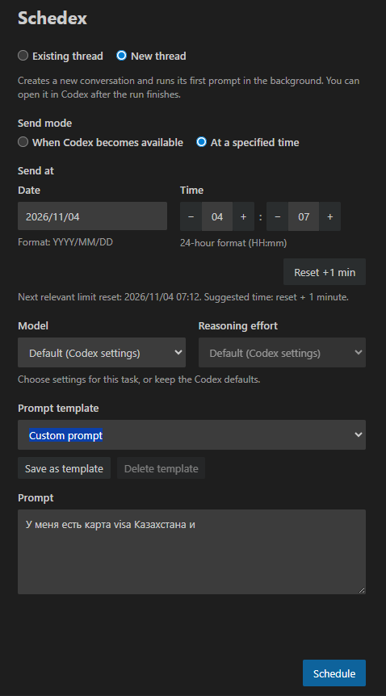

# Schedex

**Schedule prompts for Codex in VS Code.**

Send a prompt later, continue after usage limits reset, or schedule work in a new conversation.

## Quick start

Requires **VS Code 1.106.0+**, the official **OpenAI Codex** extension, and **ChatGPT sign-in**. A separate Codex CLI installation is not needed.

1. Click the **Schedex** calendar/send icon in the Codex header, or right-click inside Codex and choose **Schedule prompt**.
2. Select a recent conversation or **New thread**. Search by title, preview, or thread ID.
3. Choose a send mode, enter your prompt, and click **Schedule**.

Tasks appear below the form, where you can edit or remove them. The form keeps its values for scheduling another task. The Schedex status-bar item opens the panel; **Schedex: Scheduled prompts** also offers immediate check, send, and retry actions.

## Send modes

| Mode | Behavior |
| --- | --- |
| **When Codex becomes available** | Checks immediately, then periodically until quota and connectivity allow sending. Considers 5-hour, weekly, and selected-model limits. |
| **At a specified time** | Sends at your chosen date and time. When usage data is available, suggests the next relevant reset + 1 minute. |

**Maximum waiting period** is a deadline, not a delay: 8 days by default, adjustable from 1 to 30 days. Waiting tasks show the reason, next check, and deadline. **Check now** requests a fresh check without resetting the account binding or attempt budget.

Availability mode needs Codex to confirm readiness. If that information is unavailable, update Codex or use a specified send time. Temporary connection failures retry with backoff; account or model problems pause the task. Edit and save to resume it.

VS Code must be running to send. Tasks persist across restarts; overdue tasks and availability checks resume when Schedex starts again.

## Conversations and models

**Existing thread** keeps its model and reasoning effort from Codex and can remain open while a prompt is queued. Codex's sidebar may not expose the current conversation; in that case, choose it from the list. You can also use Codex **Copy deeplink**, then **Schedex: Use thread from Copy deeplink**.

**New thread** creates a fresh conversation. You can choose a model and supported reasoning effort, or leave **Default (Codex settings)** selected. The selection applies to the scheduled prompt; later messages keep the conversation's prior settings.

New conversations run in the background. **Open in Codex** becomes available after execution; the conversation may not appear in Codex's list before then.

## Conversation changes and templates

For existing conversations, choose what happens if messages change after scheduling:

- **Send anyway** — the default for custom prompts.
- **Skip sending** — the default for **Continue**.
- **Ask for confirmation** — keeps the task pending until you choose **Send once** or **Skip**. Confirmation survives restarts.

Protected tasks pause if history cannot be checked. Saving an edited task establishes a fresh baseline. The check happens before handoff to Codex; later conversation changes cannot cancel an accepted prompt.

Built-in templates include **Continue**, **Review changes**, **Run tests**, and **Summarize progress**. **Save as template** stores your own prompt and conversation-change policy locally. Selecting a template only fills the form.

## Task history

**History** keeps sent and cancelled tasks, their status, conversation, and available timestamps. **Queued in Codex** means waiting for execution; **Delivered to Codex** means delivery is confirmed but completion is unknown. New-thread tasks stay **Running** until finished.

Statuses refresh every 30 seconds for up to 8 days. Use **Refresh status** to check again manually. Lists have 25 entries per page; **Clear finished history** removes finished records while retaining queued, running, and unconfirmed work.

**Schedex: History Retention Days** enables automatic cleanup of old finished records. The default **0** keeps them until you clear them.

## Privacy and limits

Tasks are bound to the account selected when saved, in both send modes. Changed or unavailable authentication pauses sending. Older tasks without a binding must be edited and saved again; resaving explicitly binds the current account.

Schedex does not automatically resend an accepted prompt. If acceptance is uncertain, the task shows **Needs review**: check the conversation before retrying. **Move to History** preserves this uncertainty and keeps traceable results under monitoring; it does not cancel a prompt in Codex. Account checks cannot recall a prompt already accepted by Codex.

Prompts and templates are stored locally as plain text in VS Code extension storage. Schedex adds no cloud service; communication uses the bundled Codex runtime, with prompt text excluded from process command-line arguments.

Limits: **64 KiB** of UTF-8 text per prompt, **100** custom templates, and **16 MiB** per task/template store. Clear finished history or unused templates if storage fills up.

## Compatibility and support

Designed for Windows, macOS (Intel and Apple Silicon), Linux, and WSL. Prompt delivery has been manually verified in WSL. The interface follows the VS Code display language: English, Russian, and Simplified Chinese are included; other languages use English.

For integration problems, run **Schedex: UI diagnostics**. Report issues with your VS Code/Codex versions, OS, and reproduction steps in [GitHub Issues](https://github.com/stalin-777/schedex/issues), or contact [@bambucha762 on Telegram](https://t.me/bambucha762).

[Changelog](CHANGELOG.md) · [Development](docs/DEVELOPMENT.md) · [Manual publication](docs/PUBLISHING.md) · [MIT license](LICENSE)

## ❤️ Support the Project

If this extension saves you time and helps you code faster, consider supporting its further development! Every donation keeps the project alive and updated.

💳 **Support via Lava.top** (Supports Visa/Mastercard/Apple Pay) -> [👉 Click here to Donate](https://app.lava.top/ithlete?tabId=donate)

**Crypto Donation (Direct to Bybit)**
If you prefer crypto, you can send tips directly to these wallets:

| Asset | Network | Wallet Address |
| :--- | :--- | :--- |
| **USDT** | `TRC-20` | `TFu4UR1sA9AyYyDBaSQQ1iRKZyT1NaX3mL` |
